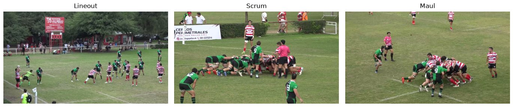
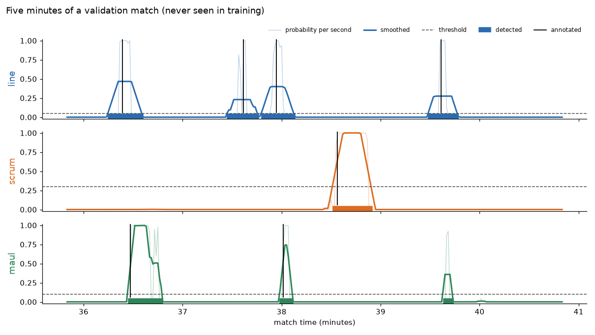
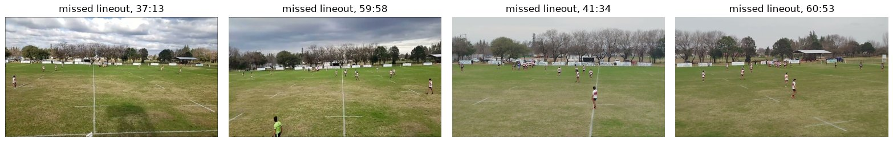

# Rugby video analysis

Automatic detection of set pieces (**lineout**, **scrum** and **maul**) in broadcast and club-camera video of amateur rugby matches from Córdoba, Argentina. This is part of my undergraduate thesis in Computer Science (Universidad Nacional de Córdoba).

The input is a full match video. The output is the time of every lineout, scrum and maul.



## How it works

```
match video
    ↓  extract 1 frame per second
frames
    ↓  YOLO-cls classifies each frame (384×384)
probability of line / scrum / maul / nothing, for every second
    ↓  smooth with a moving average
    ↓  keep the seconds above a threshold
    ↓  drop segments that are too short
events: line from 101 s to 109 s, scrum from 230 s to 245 s, ...
```

1. **Frames** (`events/extract_frames.py`): ffmpeg extracts one frame per second. It uses `fps=1:round=up` because the default filter shifts every frame by +0.5 s.
2. **Labels** (`events/labels.py`): each second gets a label (line / scrum / maul / nothing / ignore) from the hand annotations. Ambiguous seconds around each event are marked *ignore* and are not used for training.
3. **Training** (`events/build_dataset.py`, `model.py`, `train.py`): YOLO26m-cls (Ultralytics, ImageNet-pretrained) is fine-tuned on 384×384 frames for 15 epochs. All event seconds are used, plus 4 random "nothing" seconds per event second. Frames are stretched rather than cropped, because lineouts often happen at the edge of the image.
4. **Post-processing** (`events/postprocess.py`): the per-second probabilities are smoothed with a moving average, thresholded, and segments shorter than a minimum duration are dropped. A maul is only accepted if it starts right after a detected lineout.
5. **Evaluation** (`events/evaluate.py`): an event counts as detected if a detection overlaps its window (for example, lineout = [throw − 5 s, throw + 3 s]). Detections that overlap no event are false alarms. The script also sweeps thresholds and window sizes.

This is what the post-processing looks like on five minutes of a validation match. Thin lines are the raw probabilities, thick lines the smoothed ones, black marks the hand annotations and the coloured bars at the bottom the detections. The maul detected near minute 39.6 is a false alarm:



I tried two other approaches before this one. A per-frame feature model built on object detectors (Faster R-CNN / YOLO) had many more false alarms. End-to-end action-spotting models (E2E-Spot, T-DEED) overfitted on this amount of data.

## Data

- 93 annotated matches (69 train / 18 validation / 6 test), with about 2,650 lineouts, 1,600 scrums and 800 mauls.
- The split is **by venue/camera**: all matches filmed by the same camera fall in the same split, so validation measures performance on cameras the model has never seen.
- I annotated the matches with a small mpv-based tool of my own. After the first matches, the model pre-annotates and I review and correct.
- The videos, frames, annotations and trained weights are **not** included in this repository.

Annotation format (one CSV per match, times in seconds):

```
t_start,t_end,class,team,notes
59.067,,line,TEAM_A,
100.200,115.433,scrum,TEAM_B,
```

`t_start` is the throw (line), the formation (scrum: the moment a pair of second-rows of either team kneels down) or the start of the maul. `t_end` is the set (scrum: the moment the two packs engage) or the end of the maul. Rows of class `ignore` mark stretches that are not used, such as the pre-match or half-time. An event with the note `ignore` is left out of training and evaluation.

## Results (validation, 18 matches never seen in training)

| Event | Detected | False alarms per match |
|---|---|---|
| Lineout | 413 / 453 (91 %) | 0.4 |
| Scrum | 289 / 290 (99.7 %) | 0.8 |
| Maul | 142 / 176 (81 %) | 0.6 |

**Where it fails.** Most missed lineouts come from one camera (two matches at the same venue). That camera films from far away, and lineouts on the far touchline are just a small group of players at the back of the image. In those two matches the model detects 21 of 46 lineouts (46 %), and none of the 13 mauls, because mauls are only accepted after a detected lineout. In the other 16 matches, it detects 392 of 407 lineouts (96 %).



## Work in progress (not in this repository yet)

- **Which team throws the lineout / feeds the scrum**: YOLO-cls on the whole frame for lineouts. For scrums, the scrum is first cropped using YOLO segmentation.
- **Ball possession per team**: a GRU over R(2+1)D video features.

## Usage

```
data/videos/            match videos
data/annotations/       one CSV per match
data/manifest.csv       one row per match: file, camera_id, split (train / val / test), annotated (yes / no)
```

```bash
pip install -r requirements.txt
python events/extract_frames.py     # 1 fps frames
python events/train.py              # label, sample and train
python events/evaluate.py           # evaluate on validation
```

Everything was trained on a laptop RTX 3070 (8 GB) under WSL2.

## About the code

I designed the experiments, built and annotated the dataset, analysed the errors and made the modelling decisions. The code was written with AI assistance.
